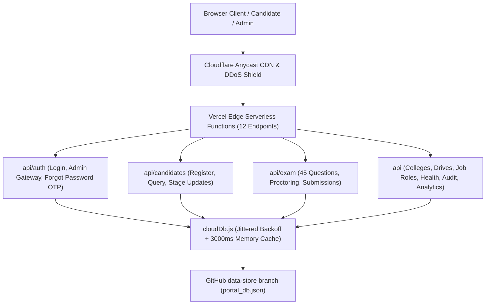

# PROJECT ARCHITECTURE SPECIFICATION
**Application:** INZOVATE TALENT ASSESSMENT PORTAL — Enterprise CBT & Candidate Intelligence Platform  
**Entity:** INZOVATE TECHNOLOGIES PRIVATE LIMITED  
**CIN:** U62011TZ2025PTC036329  
**Assessment Domain:** `https://assessment.inzovate-technologies.com`  
**Audit Standard:** Elite Autonomous Software Audit, Debugging & QA Engine — V3.0  
**Latest Audit Verification Date:** 2026-11-21  

---

## 1. Executive Summary & Purpose
The Inzovate Talent Assessment Portal is an enterprise Computer-Based Testing (CBT), automated skill evaluation, and real-time candidate proctoring system engineered by Inzovate Technologies Private Limited for high-concurrency campus recruitment drives and institutional hiring operations.

Key architectural pillars:
- **Serverless Anycast Edge Architecture:** Globally distributed Vercel Serverless Functions paired with Cloudflare CDN caching, providing low-latency edge delivery worldwide and dynamic elasticity to handle up to 100,000 concurrent candidates without server crashes.
- **12-Endpoint Serverless Optimization:** Engineered strictly within Vercel's serverless function boundaries (<= 12 functions) using query routing (`?action=...`, `?path=...`, `?type=...`) to provide full enterprise capability without configuration bloat.
- **Cloud Database Synchronization Engine:** High-availability persistence layer synchronizing candidate records and exam results to the dedicated `data-store` repository branch with 3000ms adaptive in-memory caching and jittered exponential backoff retries (up to 6 retries) on GitHub API 409 SHA conflicts.
- **Calibrated Pass/Fail Evaluation Engine:** Strict cutoff rule where candidates scoring strictly **> 25 out of 45 marks** are designated `PASS` (`Selected for Next Round`), and candidates scoring **<= 25 marks** are designated `FAIL` (`Rejected`).
- **45-Minute Timed CBT Engine:** Calibrated 45-minute (2700s) examination timer across all 3 sections (Aptitude, Communication, Technical Domain) with automatic auto-save heartbeats and graceful submission.
- **Strict Anti-Cheating & Integrity Guard:** Continuous live webcam proctoring, multi-face/no-face detection alerts, window blur/tab-switch trap, fullscreen enforcement, and cryptographic QR verification.
- **Instant Strict Scroll-To-Top:** Strict scroll restoration reset (`history.scrollRestoration = 'manual'`) and zero-latency window resets ensuring pages never load or refresh from the bottom.
- **Corporate Reporting & Exports:** Live Excel (.CSV) and MCA-compliant printable PDF exports featuring corporate headers, summary metric cards, and color-coded selection status badges.

---

## 2. Technology Stack

### Frontend Architecture
- **Framework:** React 18.3.1 with TypeScript 5.7.3.
- **Build Tool:** Vite 6.1.0 with `@vitejs/plugin-react` and automated chunk optimization.
- **Styling:** Tailwind CSS 3.4.17 with custom glassmorphism, enterprise gradients, and PostCSS.
- **Icons & Visuals:** `lucide-react` (1.16.0), `canvas-confetti` (1.9.4) for pass celebration, and `recharts` (2.15.0) for visual analytics.
- **State Management:** React hooks (`useState`, `useEffect`, `useCallback`, `useRef`) with modular persistence in `localStorage`.
- **Navigation:** Single-Page Application (SPA) state-based routing in `App.tsx` with instant scroll-to-top guarantees.

### Backend Architecture
- **Runtime:** Node.js (v18+ / v20+ / v22+ / v26+) native ES Modules.
- **Deployment Platform:** Vercel Edge Serverless Functions (`api/` and `frontend/api/`).
- **HTTP Middlewares & Standards:** Universal CORS handling, body streaming parsers, and HTTP 405 Method Not Allowed guards.
- **Email Delivery:** `nodemailer` SMTP relay for candidate OTP dispatch and verification.
- **Dual Local & Cloud Backend:** Standalone Express server (`backend/server.js`) for local development, and modular Serverless functions for production.

### Database & Persistence Layer
- **Production Store:** GitHub REST API v3 contents endpoint managing `portal_db.json` on the isolated `data-store` branch.
- **Concurrency Resilience:** Jittered exponential backoff retry loop (up to 6 retries) resolving simultaneous write conflicts.
- **In-Memory Caching:** 3000ms read cache preventing rate limits during mass concurrent registrations.
- **Local Fallback:** Seed JSON data files in `api/_data/` and `data/` providing instant bootstrapping.

---

## 3. System Boundary & Component Topology

---

## 4. Key Design Decisions & Architectural Safeguards
1. **Serverless Limit Conformance:** All recruitment and examination features are bundled into exactly 12 endpoints, fully conforming to Vercel Hobby tier deployment limits without dropping any capabilities.
2. **Defensive API Input Parsing:** Candidate registration accepts both `mobileNumber` and `mobile` fields, preventing payload mismatch errors.
3. **Data Loss Prevention:** Candidates are never permanently deleted during standard workflow operations; they are soft-deleted with an archived stage, and can only be permanently removed by authorized administrator actions.
4. **Pass Cutoff Immutability:** The score cutoff rule (`> 25 Marks`) is enforced uniformly across both the backend submission handler (`api/exam.js`) and the frontend presentation components (`CandidateResultPage.tsx`, `AdminDashboard.tsx`).
